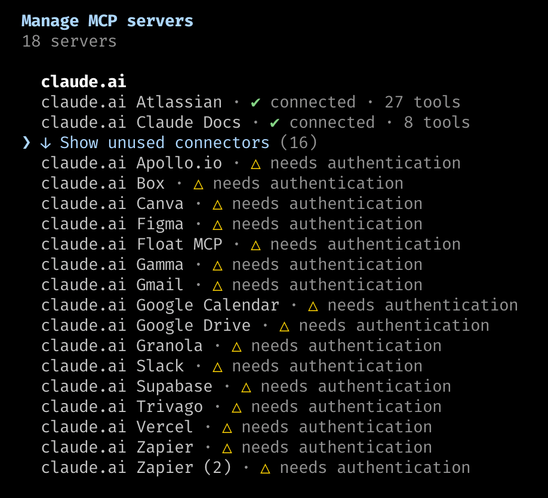
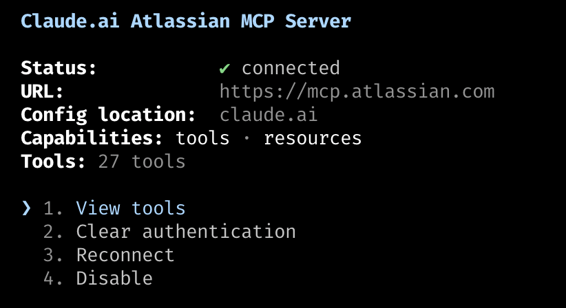

# MCP-to-CLI conversion: Atlassian / Jira

Session 5 deliverable — integration strategy. Measured 2026-10-01 against
`tripleseat.atlassian.net` with Claude Code on Opus 5 (1M context).

Every number below came from `/context` or from `wc -c` on a real response. None
are estimates unless marked as such.

---

## 1. Every MCP server in the workspace

18 servers, all user-scoped via the claude.ai connector config. No `.mcp.json`
in any project, so nothing is project-scoped.

`/mcp` after this exercise:



**2 connectors in use, 16 unused.** Atlassian is one of only two doing any work,
and it only started during this exercise.

### `claude mcp list` and `/mcp` disagree

`claude mcp list` reported Gmail, Google Calendar, Google Drive and Trivago as
`✔ Connected`. `/mcp` shows all four under **needs authentication**.

The CLI's status is a reachability ping against the server URL — it says the
endpoint answered, not that you are authorized. Only `/mcp` reports auth state.
This cost real time during the exercise: Google Calendar was picked as the first
conversion candidate partly because `claude mcp list` called it connected, and
it was not.

**If you are inventorying MCP servers, use `/mcp`, not `claude mcp list`.**

## 2. The three most frequently called tools, per server

This step produced the most useful finding of the assignment, by failing.

Parsing every `tool_use` block across all 91 session transcripts in
`~/.claude/projects/`:

```
1  mcp__claude_ai_Atlassian__authenticate
```

**One MCP call, ever, and it was a login that did not complete.** Not one server
had a "three most frequently called tools" to report. 18 connectors were mounted;
zero were doing work.

A first pass counted 69 calls, which was wrong — it matched tool *definitions*
stored in the transcripts rather than invocations. Worth stating because the
mistake is easy to repeat: grep for `tool_use` blocks, not for tool names.

The deck's conversion trigger is "same tool, same shape, 10× a day." Nothing here
was within three orders of magnitude of it. The question the assignment implies —
which frequent call should become a CLI? — had no answer from usage data, so the
candidate was chosen from workflow evidence instead: the Tripleseat repo is full
of `TPD-####` tickets, `jira/*.xml` exports, and ticket-named analysis files.
Jira is the daily read whether or not it had been going through MCP.

## 3. The conversion

**Target:** `searchJiraIssuesUsingJql` — the "what am I working on" read.

**Wrapper:** `.claude/skills/jira-cli/jira-cli` — `curl` against the Jira REST
API v3, piped through `jq`.

**Skill:** `.claude/skills/jira-cli/SKILL.md` — teaches when to use the wrapper
and when to fall back to the MCP.

Authentication is the part the deck glosses over. The MCP's OAuth token lives on
Atlassian's proxy at `mcp.atlassian.com`, not on the local machine, so a shell
script cannot borrow it. The wrapper needs a separate API token from
`id.atlassian.com`. This is why `gh issue list` is the deck's example: the GitHub
CLI is already authenticated, and most MCP servers have no such counterpart.

Verified identical: both paths return the same five issues for the same
`accountId` (`712020:73464ce4…`).

## 4. Before / after

### Per-call cost

Query: `assignee = currentUser() AND resolution = Unresolved ORDER BY updated DESC`

| | MCP | `jira-cli` |
|---|---|---|
| Response into context | ~5.9 KB JSON | **480 bytes** |
| Useful signal | 480 bytes | 480 bytes |
| Overhead ratio | ~12× | 1× |

The MCP response carried, for each of five issues: a `self` API URL, an `expand`
string listing seven unused representations, an `iconUrl`, a nested
`statusCategory` object, an issue-type description in Spanish, and a `webUrl`.
Then a trailing `context` block with an `atlassianAccountId`, a `sessionId`, an
`invocationId`, and seven internal Atlassian feature flags.

The tool takes a `fields` parameter. I passed six fields. All of the above arrived
anyway — there is no parameter that suppresses it. `jq` discards it client-side
before it reaches the model.

### Mounting cost

The connector, once authorized — 27 tools arriving as one indivisible block:



All 27 schemas, costed from `/context`:

| Group | Tools | Tokens |
|---|---|---|
| Jira | 11 | 4,227 |
| Confluence | 8 | 4,724 |
| Compass | 3 | 1,320 |
| Teamwork Graph / misc | 5 | 3,067 |
| **Total** | **27** | **13,338** |

Heaviest single tool: `getTeamworkGraphContext` at 1,600 tokens. Mean: 494.

**Confluence and Compass together are 6,044 tokens — 45% of the connector — for
surfaces that never come up in a code session.** The connector is not separable;
authorizing Jira mounts all of it.

### Two honest corrections to the lecture's model

**The tax is 13.3k, not 55k.** The deck quotes ~55,000 tokens per MCP connection.
Atlassian — a large connector, 27 tools — measures at 13,338. The deck's figure
is roughly 4× high for this server. The direction of the argument holds; the
magnitude does not.

**Deferred loading has already solved most of the mounting problem.** `/context`
reports MCP tools at **1k resident, 22k deferred**. Claude Code does not keep
every schema in the window; it loads them on demand when a search matches. The
13,338 figure is what Atlassian costs fully loaded, not what it costs at rest.
Doing this exercise, only the four tools actually used became resident — 2,046
tokens, not 13,338.

That substantially weakens the mounting-cost case for CLI conversion in Claude
Code specifically. It does not touch the per-call case: deferred loading cannot
shrink a response, and the response is where the recurring waste is.

## 5. What actually justifies the conversion

Not the 275× headline. For this server, in this harness, the real argument is
narrower and holds up better:

1. **Response shape is not negotiable over MCP.** A tool returns what its author
   decided it returns. A CLI pipeline filters before the context window, so the
   saving is real and repeats on every call.
2. **Connectors are all-or-nothing.** 45% of Atlassian's schema cost is
   Confluence and Compass. There is no way to mount only the Jira half.
3. **Tool-count discipline.** The deck's Rule of Seven caps a specialist at ≤7
   tools. One connector brings 27.

Conversely, the MCP earns its place for exploration — `getJiraIssueTypeMetaWithFields`
would be tedious to replicate — and for writes, where typed validation runs before
the change lands. The wrapper is deliberately read-only for that reason.

## 6. Reproducing this

```bash
export JIRA_SITE=your-org.atlassian.net
export JIRA_EMAIL=you@example.com
export JIRA_API_TOKEN=...   # id.atlassian.com/manage-profile/security/api-tokens

.claude/skills/jira-cli/jira-cli mine | column -t -s $'\t'
```

Measure both sides the same way:

```bash
# CLI side
.claude/skills/jira-cli/jira-cli --raw mine | wc -c    # raw API response
.claude/skills/jira-cli/jira-cli mine | wc -c          # what enters context

# MCP side
# run /context before and after a searchJiraIssuesUsingJql call
```

Transcript tool-call frequency, which is step 2 for any server:

```bash
find ~/.claude/projects -name '*.jsonl' -print0 | xargs -0 cat | python3 -c '
import sys, json, collections
c = collections.Counter()
for line in sys.stdin:
    try: o = json.loads(line)
    except: continue
    ct = (o.get("message") or {}).get("content")
    if not isinstance(ct, list): continue
    for b in ct:
        if isinstance(b, dict) and b.get("type") == "tool_use" and str(b.get("name","")).startswith("mcp__"):
            c[b["name"]] += 1
for k, v in c.most_common(30): print(f"{v:5d}  {k}")
'
```
